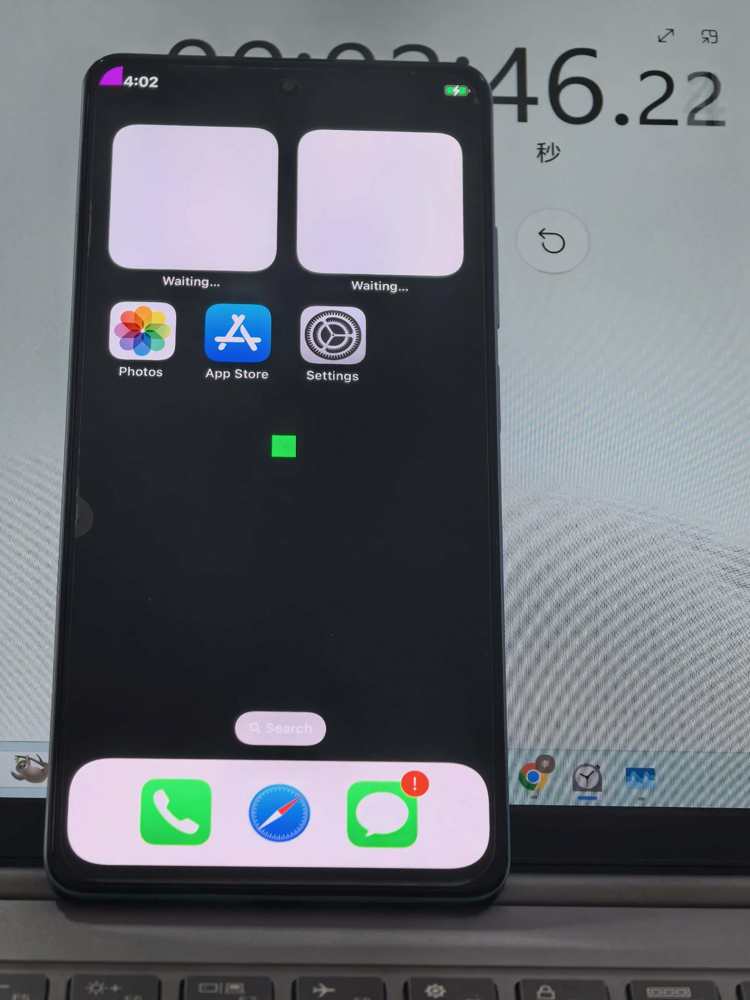

# ruby-ios-bringup

[English](README.md) · **中文**

**在 MediaTek MT6877 手机上运行 XNU 8796 + iPhone X iOS 16.7.16 用户态。**
一个研究性 bring-up，以独立、脱敏的增量形式打包。

> **状态 2026-10-21：** 首次启动约 60 秒到锁屏（实测 58 秒）；热重启约
> 22 秒到锁屏。内核合成上滑解锁到桌面，动画正常。真实触摸、按键、USB、
> Wi-Fi、GPU、RTC 仍未通。
>
> **设备回归测试：** 这次打包没有做设备回归；进桌面是历史结果（boot23），
> CI 只覆盖内核构建。见 [`GUARANTEE.zh.md`](GUARANTEE.zh.md)。

## 演示

[](media/autoswipe.mp4)

**点击图片播放 12 秒片段**（720p60，2.6 MB）：锁屏 → 内核合成上滑 → 桌面。
2026-10-21 在 0084 构建上拍摄；已去除元数据和音轨。见
[`media/README.zh.md`](media/README.zh.md)。

仓库**不含 Apple 固件、iOS root、设备 dump 或 diff 数据**。内核由固定上游
基线 + 本项目增量构建；工作流会先校验还原出的树再编译。

## 一览

| 领域 | 状态 |
|---|---|
| 启动 | stock LK → 128 MiB boot 镜像 → XNU 8796 → HFS+ root |
| CPU | 6× Cortex-A55，16K 页，GICv3，定时器 |
| 显示 | IOSurface/IOMFB → LK framebuffer，1080×2400 |
| 用户态 | launchd → lsd → backboardd → SpringBoard |
| 输入 | 仅合成 HID 上滑；真实 Goodix 未移植 |
| 存储 | UFS LUN 2，`iosroot` 上读写 HFS+ |
| 未通 | 触摸/按键、USB、Wi-Fi、GPU、RTC |
| 安全 | AMFI/sandbox/签名关闭；可能丢数据 |

## 这个里程碑的意义

难点不是“把 XNU 跑起来”，而是三处静默失败：LK 只接受的 128 MiB 镜像布局、
真正上屏的显示路径，以及一个看起来像内核 bug、实际卡在用户态
`MobileGestalt` 消费者的 LaunchServices 首启死锁。仓库记录精确字节、证据
和走过的弯路。

## 仓库结构

| 路径 | 内容 |
|---|---|
| `README.md`、`STATUS.md`、`SCOPE.md`、`SAFETY.md` | 入口与边界 |
| `ACKNOWLEDGEMENTS.zh.md`、`LEGAL.zh.md` | 致谢与法律风险声明 |
| `docs/en/`、`docs/zh/` | 英文与中文章节 |
| `patches/` | 自有 XNU 增量：0080 UFS、0084 autoswipe；历史 0081-0083 |
| `ci/` | 基线 recipe、固定 patchset 哈希与来源 |
| `config/` | 0084 构建 pin 与启动 cmdline |
| `.github/workflows/xnu.yml` | 复现可启动的 0084 内核 |
| `src/bringup/` | 早期启动 payload、shim、镜像打包 |
| `src/ufs-probe/` | MT6877 UFS 只读探针 |
| `tools/image/` | ICL 补丁、dyld 扫描、boot 校验 |
| `tools/twrp/` | 已验证的块 diff/patch，仅 TWRP |
| `scripts/` | 基线拉取、本地验证 |
| `media/` | 脱敏演示片段、桌面照片与拍摄规范 |

## 构建与验证

```sh
# 主机检查：不碰设备、不写镜像
python scripts/verify-local.py
```

内核工作流使用：

```text
base:     MakrSas/ios-topaz @ 5095ac19dbdcf37b64b81fe443f4027ad51b84bf
recipe:   ci/prepare-baseline.sh（不 vendor 上游树）
patchset: de1824c28b5e56f7c60988c33501cd5bbfd24a4159d9358223fd2af11392d360
runner:   macos-14 / Xcode 15.0.1 / macOS 13.5 xnu
config:   DEVELOPMENT, MACHINE_CONFIG=SWEET, -mcpu=cortex-a55
```

recipe 删除 topaz 补丁、加入本项目补丁、应用 0010/0012 小改动、统一换行；
patchset 哈希不匹配就停止。boot 镜像本身**不在**仓库里；`tools/image/`
提供离线校验和补丁工具。

Host 管线（不碰设备、不碰 root）：`scripts/test-pipeline.sh`，输入 base
boot、kernel、ADT、shim 和 0084 golden；生成 payload、确定性 boot 镜像并
校验布局；见 `docs/zh/09-reproduce.md`。

## 设备情况

| 项 | 值 |
|---|---|
| 设备 | Redmi Note 12 Pro 5G，`ruby` / MT6877，8 GB + 256 GB |
| 系统 | Android 12 / MIUI 13.0.4，已解锁，Magisk，slot `_a` |
| 布局 | `userdata` 208.4 GiB + `iosroot` 17 GiB；`boot_a` 128 MiB；`super` 约 9.1 GB |
| 当前状态 | `boot_a` 为 0084 XNU 镜像；Android 未恢复；`iosroot` 保留 ICL NOP |
| 成功工件 | 0084 镜像、内核、root 镜像、ICL 块、boot cmdline |
| 需匹配 | 固件/GPT、root hash、boot 镜像、启动参数、面板/显示 |
| 不需要 | 触摸固件、Wi-Fi、USB、GPU、RTC |

设备基线哈希（GPT/boot/vbmeta）**不发布**，因为可能成为设备指纹；工件
hash 在 `config/0084.env`。见 [`docs/zh/device.md`](docs/zh/device.md)。

## 边界与安全

- 默认路径会写 iOS root，可能清掉 Android 数据。**按会丢数据准备。**
- 双系统布局只是附录**方法说明**，不是安装器。
- 不含 Apple 固件，不连 Apple 激活服务器，不放个人数据。
- 刷机前读 [`SAFETY.md`](SAFETY.md) 和 [`SCOPE.md`](SCOPE.md)。
- 内容政策：不要发布或索要 Apple 固件、iOS root、dyld 缓存、设备 dump、
  序列号/IMEI/MAC 或个人信息。见 issue 模板
  （`.github/ISSUE_TEMPLATE/`）和 [`CONTRIBUTING.md`](CONTRIBUTING.md)。

## 保证

成功路径——启动到锁屏、合成上滑到桌面——采用**文档级（理论）保证**：同设备
基线、同 root/boot 工件 hash、同启动参数、按文档步骤操作。它不是已经独立
复现的设备保证；更详细的测试保证因时间和精力暂缓；失败路线只是历史证据，
不在保证范围内。见 [`GUARANTEE.zh.md`](GUARANTEE.zh.md)。

## 文档

从 [`docs/README.md`](docs/README.md) 开始，或直接进入
[English chapters](docs/en/README.md) / [中文章节](docs/zh/README.md)。

## 致谢与法律

见 [`ACKNOWLEDGEMENTS.zh.md`](ACKNOWLEDGEMENTS.zh.md) 和
[`LEGAL.zh.md`](LEGAL.zh.md)。媒体拍摄规范见
[`media/CAPTURE.zh.md`](media/CAPTURE.zh.md)。

## 许可

自有代码与文档 MIT；XNU 补丁按 APSL 2.0；上游与排除内容见
[`NOTICE`](NOTICE)。

**上游声明：** `ios-sweet` 和 `ios-topaz` 在固定 commit 上**没有 LICENSE
文件**。本仓库不 vendor 上游树，只发布 recipe 和本项目补丁；不声称已获得
上游许可。见 [`LEGAL.zh.md`](LEGAL.zh.md)。
